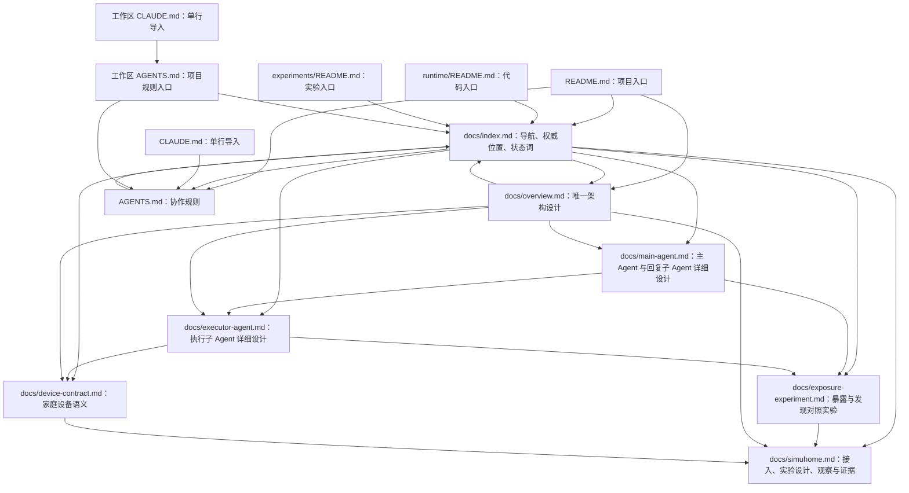

# 伴居 · 文档地图

采用 `small` 文档结构：目标架构集中在 `overview.md`，家庭设备契约、主 Agent 与执行子 Agent 详细设计、对照实验设计与实际运行验证分别维护在独立权威页。代码与实验位于并列仓库，文档以真实设计职责和运行依据组织。

## 阅读路线

- 1 分钟了解范围：[项目入口](../README.md) → [目标与范围](overview.md#目标与范围)。
- 5 分钟理解系统：[软件架构图](overview.md#软件架构图) → [角色与运行内核](overview.md#角色与运行内核) → [任务与事件](overview.md#任务与事件)。
- 研究设备能力：[工具与设备接入](overview.md#工具与设备接入) → [家庭设备工具契约](device-contract.md)。
- 研究主 Agent：[角色与运行内核](overview.md#角色与运行内核) → [主 Agent 详细设计](main-agent.md)。
- 研究执行子 Agent：[委派与反馈](overview.md#委派与反馈) → [执行子 Agent 详细设计](executor-agent.md) → [工具暴露与设备发现对照实验](exposure-experiment.md)。
- 研究记忆与成长：[记忆与状态](overview.md#记忆与状态) → [反馈与自适应](overview.md#反馈与自适应)。
- 准备实现或实验：[取舍与详细设计边界](overview.md#取舍与详细设计边界) → [仿真与实物边界](overview.md#仿真与实物边界)。
- 运行本地实验：[SimuHome 本地验证](simuhome.md) → 拟议的[验证实验设计](simuhome.md#验证实验设计)；启动与使用[实时可视化观察层](simuhome.md#实时可视化观察层)。
- 定位工作内容：[工作区与仓库分工](#工作区与仓库分工) → [实验 Agent 目录约定](#实验-agent-目录约定) → [协作规范](../AGENTS.md)。
- 开始修改：[协作规范](../AGENTS.md) → 本文的权威位置表 → 对应架构章节。

## 文档架构图

下图只表示阅读与引用路径。运行组件和数据交互见[软件架构图](overview.md#软件架构图)，两者不混用。



## 工作区与仓库分工

以下为当前本地工作区的主要文件结构。三个目录是并列的独立 Git 仓库；工作区根目录保存本地编码代理入口。实验 Agent 的目标组织方式见[目录约定](#实验-agent-目录约定)，该目标结构尚未迁移。

```text
工作区/
  AGENTS.md
  CLAUDE.md
  home_agent/                 # 架构文档仓库
    .git/
    README.md
    AGENTS.md
    CLAUDE.md
    docs/
      index.md
      overview.md
      device-contract.md
      main-agent.md
      executor-agent.md
      exposure-experiment.md
      simuhome.md
  experiments/                # 验证实验仓库
    .git/
    README.md
    observer/                 # 实验观察层（跨 Agent 复用）
      server.py
      device_catalog.json
      web/                    # 页面前端工程（React + antd）
    scenarios/
      bedroom_light.json
      contract_devices.json
    simuhome-source.json
    simuhome-coverage.json
    smoke_simuhome.py
    check_contract.py
    check_coverage.py
    run_agent.py
  runtime/                    # Agent 代码仓库
    .git/
    README.md
    banju/
    tests/
```

| 仓库 | 远程仓库（私有） | 应承载的内容 | 与其他仓库的关系 |
| --- | --- | --- | --- |
| `home_agent/` | `hongyue0721/home_agent` | 产品目标、架构设计、文档地图与项目协作规则 | 为代码实现与验证实验提供统一规范 |
| `experiments/` | `hongyue0721/home_agent-experiments` | 按 Agent 名称组织的实验实现、提示词、配置、场景、入口、结果及观察界面 | 按下方目录约定存放实验 Agent，复用 `runtime/` 内核，按架构验证要求提供证据 |
| `runtime/` | `hongyue0721/home_agent-runtime` | 可复用运行内核、任务、工具、记忆、技能、设备接入与正式应用实现及其测试 | 按 `home_agent/` 的架构实现通用能力，供正式应用和实验 Agent 使用 |

当前 `runtime/` 提供本地小 Agent 与后端适配代码，`experiments/` 提供真实 SimuHome 接口实验、真实模型实验入口和[实验观察层](simuhome.md#实时可视化观察层)。三个仓库分别管理版本，远程地址见上表，本地目录名与远程仓库名不必一致；实验记录关联场景、预期上游提交和被测源码摘要，已提交版本可同时关联提交标识。具体运行与证据覆盖见[本地验证](simuhome.md)。仓库分工描述文件归属，运行组件关系以[软件架构图](overview.md#软件架构图)为准。

在空的工作区目录中按以下目录名获取三个仓库，以符合文档中的相对路径：

```bash
git clone https://github.com/hongyue0721/home_agent.git home_agent
git clone https://github.com/hongyue0721/home_agent-experiments.git experiments
git clone https://github.com/hongyue0721/home_agent-runtime.git runtime
```

工作区 `AGENTS.md` 指向项目协作规则与本文，工作区 `CLAUDE.md` 导入该入口。它们位于三个仓库之外，随本地工作区维护。单独获取 `home_agent/` 仓库时，得到的是本仓库文件，而不是整个工作区。

[Claude Code 入口](../CLAUDE.md)只导入 [AGENTS.md](../AGENTS.md)。其他编码代理如需入口，同样引用唯一规则文件，不建立规则副本。

## 实验 Agent 目录约定

目标目录为 `experiments/agents/<agent_name>/`。每个实验 Agent 按自己的名称拥有独立目录，专属实现、角色提示词、配置、场景、验证入口及运行结果在该目录中维护。

`agent_name` 标识被测 Agent 或策略实现；模型名和场景名作为运行配置或实验元数据记录。例如，执行子 Agent 的实验目录为 `experiments/agents/home_executor/`，`spark-x2.5-4b` 是它使用的模型之一。

以下为目标布局。`home_executor` 已按此布局建立（见[工具暴露与设备发现对照实验](exposure-experiment.md)）；其余现有验证代码尚未迁移，交付状态：`PLANNED`。

```text
experiments/
  agents/
    <agent_name>/
      实验 Agent 实现、提示词、配置、场景与入口
      results/
        <run_id>/
          本次运行的记录与证据
```

实验 Agent 通过共享运行内核与统一工具契约工作，实验专属角色和组合逻辑在名称目录中实现。可复用内核与正式应用实现由 `runtime/` 维护。平台来源记录、共同使用的仿真环境和确有复用关系的实验辅助代码由实验仓库统一维护。

现有验证代码尚保持当前路径；后续目录迁移应按以下归属处理，并同步导入、启动命令和验证记录：

| 当前内容 | 目标归属 |
| --- | --- |
| `runtime/banju/cli.py` 中的实验角色提示词和仿真组合入口 | 对应的 `experiments/agents/<agent_name>/` |
| `experiments/run_agent.py` 与 Agent 专属场景 | 对应的 `experiments/agents/<agent_name>/` |
| Agent 专属运行结果 | `experiments/agents/<agent_name>/results/<run_id>/` |
| 共享运行循环、模型接入与统一工具契约实现 | `runtime/` 中对应的可复用模块 |

当前已执行命令与证据仍按[本地验证](simuhome.md)中的实际路径保留。目录迁移由后续明确授权的代码任务完成。观察层作为跨 Agent 复用组件位于 `experiments/observer/`，不随单个实验 Agent 迁移；其规范与交付状态见[实时可视化观察层](simuhome.md#实时可视化观察层)。


## 权威位置与维护人

Authority（权威位置）是规范事实的唯一维护位置；Maintainer（维护人）是有权批准该事实变更的人。其他页面只能摘要并链接，不能另立同一事实的第二份规范。

| 信息 | Authority（权威位置） | Maintainer（维护人） | 修改触发 | 关联更新 |
| --- | --- | --- | --- | --- |
| 产品范围、软件架构、角色与模块职责 | [docs/overview.md](overview.md) | 鸿岳 | 目标、运行组件或职责边界变化 | 本文导航；README 必要摘要 |
| 任务、记忆、反馈与实验边界 | [docs/overview.md](overview.md) | 鸿岳 | 数据语义、任务流程或验证边界变化 | 本文对应阅读路线；实现与实验 |
| 家庭设备工具语义与后端适配边界 | [docs/device-contract.md](device-contract.md) | 鸿岳 | 统一能力、状态、动作或证据语义变化 | 架构引用；runtime；对应实验 |
| 主 Agent 的职责边界、第一阶段范围、决策与委派、子任务结果处理、回复子 Agent 约束与主 Agent 验证计划 | [docs/main-agent.md](main-agent.md) | 鸿岳 | 主 Agent 或回复子 Agent 的职责、决策、结果处理或验证计划变化 | 架构角色章节；执行子 Agent 结构化结果；对照实验 |
| 执行子 Agent 的任务输入、结构化结果、范围检查与发现/暴露候选策略 | [docs/executor-agent.md](executor-agent.md) | 鸿岳 | 子 Agent 输入输出、范围检查或候选策略变化 | 架构动态暴露章节；runtime；对照实验 |
| 工具暴露与设备发现对照实验：对照组、规模、工具目录来源、扩展用例、变体与追加判定 | [docs/exposure-experiment.md](exposure-experiment.md) | 鸿岳 | 对照组、规模档位、工具来源、判定或统计方法变化 | 基础实验设计；实验场景与来源清单 |
| SimuHome 接入、本地验证、验证实验设计与实验观察要求 | [docs/simuhome.md](simuhome.md) | 鸿岳 | 上游版本、运行方式、实验用例与判定、观察要求或证据覆盖变化 | 架构图；仓库入口；实验场景与来源记录 |
| 工作区目录、仓库分工、实验 Agent 目录与版本关联 | [docs/index.md](index.md#工作区与仓库分工)；[实验 Agent 目录约定](#实验-agent-目录约定) | 鸿岳 | 本地目录、Agent 文件归属、仓库职责或实验关联方式变化 | 工作区入口；README；项目协作规则的引用 |
| 文档导航、权威归属和状态术语 | [docs/index.md](index.md) | 鸿岳 | 文件结构、维护归属或状态规则变化 | README、AGENTS 的引用 |
| 项目协作、维护和提交规则 | [AGENTS.md](../AGENTS.md) | 鸿岳 | 工作流程变化 | 工作区及编码代理入口引用 |

README 是入口摘要，不拥有独立的运行架构或行为规范。本地实现与仿真证据的覆盖范围见[本地验证](simuhome.md#证据覆盖)，软件整体状态与局部验证分开维护。

## 状态术语

状态术语只在本节定义。架构文件引用本节，不重复维护定义。

| 维度 | 状态 | 含义与依据 |
| --- | --- | --- |
| Specification status（规范状态） | `PROPOSED` | 设计草案，尚无正式批准记录 |
| Specification status（规范状态） | `ACCEPTED` | 已批准的现行规范，必须链接 PR、评审意见或 ADR 中的批准记录 |
| Specification status（规范状态） | `REJECTED` | 方案被否决，保留相应评审依据 |
| Specification status（规范状态） | `SUPERSEDED` | 已由其他规范替代，必须链接替代位置 |
| Specification status（规范状态） | `ARCHIVED` | 不再适用，仅作历史参考 |
| Delivery status（交付状态） | `PLANNED` | 尚未实现 |
| Delivery status（交付状态） | `IMPLEMENTED` | 对应代码已实现并合并，尚未具备充分验证证据 |
| Delivery status（交付状态） | `VERIFIED` | 存在对应测试命令与结果、CI 链接或演示记录，并明确证据覆盖范围 |
| Documentation impact（文档影响） | `UPDATED` | 本次已更新受影响的权威文档和必要引用 |
| Documentation impact（文档影响） | `NOT_NEEDED` | 无需文档语义变更，必须说明理由 |
| Documentation impact（文档影响） | `BLOCKED` | 存在未解决的规范冲突或缺少所需批准，不静默修改事实 |

规范状态从 `PROPOSED` 进入 `ACCEPTED` 或 `REJECTED`，以后可被替代或归档。交付状态与规范状态独立，不能因文档写完或链接检查通过，就提升软件交付状态。

未运行的检查记录为 `NOT_RUN` 并说明原因，不作为通过证据。当前架构文件保持草案与计划状态；写入文档的授权不替代对后续接口、数据模型和技术选型的具体批准。

## 维护方式

先修改事实所属的权威位置，再同步阅读路线、链接、图和必要示例。改变已批准设计前由维护人确认，不为了匹配模板而改变语义。

仅当已有内容确实需要独立维护时才拆分页面，并同步本页唯一的权威表、目录和文档图。安装、API、配置、迁移和运维文档等待真实实现与操作依据，不提前生成空壳。

结构检查使用已安装的 `project-documentation-architect` Skill 提供的 `check --strict`；语义仍须对照需求和实现人工检查。当前未启用文档 CI，不将本地检查描述成自动门禁。
