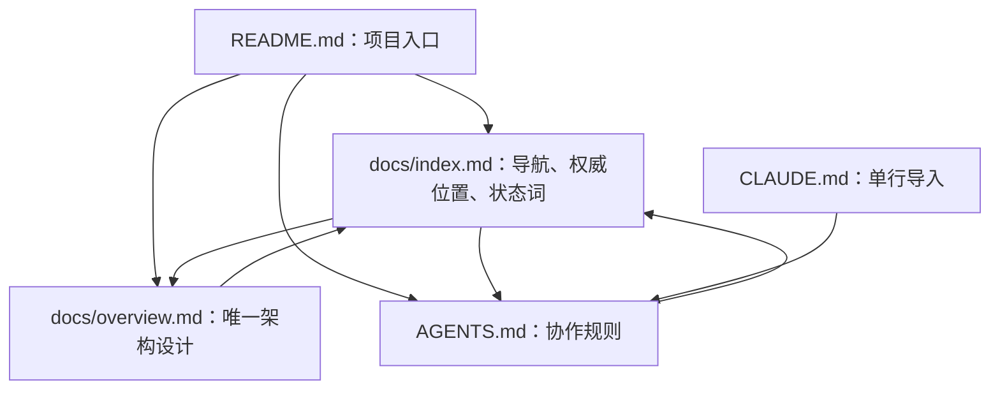

# 伴居 · 文档地图

采用 `small` 文档结构：当前只有架构设计，没有需要单独维护的 API、数据库实现、部署流程或运维手册。设计集中在一个权威文件，不为未实现能力创建空目录和占位参考页。

## 阅读路线

- 1 分钟了解范围：[项目入口](../README.md) → [目标与范围](overview.md#目标与范围)。
- 5 分钟理解系统：[软件架构图](overview.md#软件架构图) → [角色与运行内核](overview.md#角色与运行内核) → [任务与事件](overview.md#任务与事件)。
- 研究设备能力：[工具与设备接入](overview.md#工具与设备接入)。
- 研究记忆与成长：[记忆与状态](overview.md#记忆与状态) → [反馈与自适应](overview.md#反馈与自适应)。
- 准备实现或实验：[取舍与详细设计边界](overview.md#取舍与详细设计边界) → [仿真与实物边界](overview.md#仿真与实物边界)。
- 开始修改：[协作规范](../AGENTS.md) → 本文的权威位置表 → 对应架构章节。

## 文档架构图

下图只表示阅读与引用路径。运行组件和数据交互见[软件架构图](overview.md#软件架构图)，两者不混用。



## 文件结构

```text
README.md
AGENTS.md
CLAUDE.md
docs/
  index.md
  overview.md
```

[Claude Code 入口](../CLAUDE.md)只导入 [AGENTS.md](../AGENTS.md)。其他编码代理如需入口，同样引用唯一规则文件，不建立规则副本。

## 权威位置与维护人

Authority（权威位置）是规范事实的唯一维护位置；Maintainer（维护人）是有权批准该事实变更的人。其他页面只能摘要并链接，不能另立同一事实的第二份规范。

| 信息 | Authority（权威位置） | Maintainer（维护人） | 修改触发 | 关联更新 |
| --- | --- | --- | --- | --- |
| 产品范围、软件架构、角色与模块职责 | [docs/overview.md](overview.md) | 鸿岳 | 目标、运行组件或职责边界变化 | 本文导航；README 必要摘要 |
| 任务、工具、记忆、反馈与实验边界 | [docs/overview.md](overview.md) | 鸿岳 | 数据语义、任务流程、能力范围或验证边界变化 | 本文对应阅读路线；后续实现与实验 |
| 文档导航、权威归属和状态术语 | [docs/index.md](index.md) | 鸿岳 | 文件结构、维护归属或状态规则变化 | README、AGENTS 的引用 |
| 仓库协作、维护和提交规则 | [AGENTS.md](../AGENTS.md) | 鸿岳 | 工作流程变化 | 编码代理入口引用 |

README 是入口摘要，不拥有独立的运行架构或行为规范。当前没有实现代码作为软件行为证据，也没有已发布的机器可读契约。

## 状态术语

状态术语只在本节定义。架构文件引用本节，不重复维护定义。

| 维度 | 状态 | 含义与依据 |
| --- | --- | --- |
| Specification status（规范状态） | `PROPOSED` | 设计草案，尚无正式批准记录 |
| Specification status（规范状态） | `ACCEPTED` | 已批准的现行规范，必须链接 PR、评审意见或 ADR 中的批准记录 |
| Specification status（规范状态） | `REJECTED` | 方案被否决，保留相应评审依据 |
| Specification status（规范状态） | `SUPERSEDED` | 已由其他规范替代，必须链接替代位置 |
| Specification status（规范状态） | `ARCHIVED` | 不再适用，仅作历史参考 |
| Delivery status（交付状态） | `PLANNED` | 尚未实现 |
| Delivery status（交付状态） | `IMPLEMENTED` | 对应代码已实现并合并，尚未具备充分验证证据 |
| Delivery status（交付状态） | `VERIFIED` | 存在对应测试命令与结果、CI 链接或演示记录，并明确证据覆盖范围 |
| Documentation impact（文档影响） | `UPDATED` | 本次已更新受影响的权威文档和必要引用 |
| Documentation impact（文档影响） | `NOT_NEEDED` | 无需文档语义变更，必须说明理由 |
| Documentation impact（文档影响） | `BLOCKED` | 存在未解决的规范冲突或缺少所需批准，不静默修改事实 |

规范状态从 `PROPOSED` 进入 `ACCEPTED` 或 `REJECTED`，以后可被替代或归档。交付状态与规范状态独立，不能因文档写完或链接检查通过，就提升软件交付状态。

未运行的检查记录为 `NOT_RUN` 并说明原因，不作为通过证据。当前架构文件保持草案与计划状态；写入文档的授权不替代对后续接口、数据模型和技术选型的具体批准。

## 维护方式

先修改事实所属的权威位置，再同步阅读路线、链接、图和必要示例。改变已批准设计前由维护人确认，不为了匹配模板而改变语义。

仅当已有内容确实需要独立维护时才拆分页面，并同步本页唯一的权威表、目录和文档图。安装、API、配置、迁移和运维文档等待真实实现与操作依据，不提前生成空壳。

结构检查使用已安装的 `project-documentation-architect` Skill 提供的 `check --strict`；语义仍须对照需求和实现人工检查。当前未启用文档 CI，不将本地检查描述成自动门禁。
