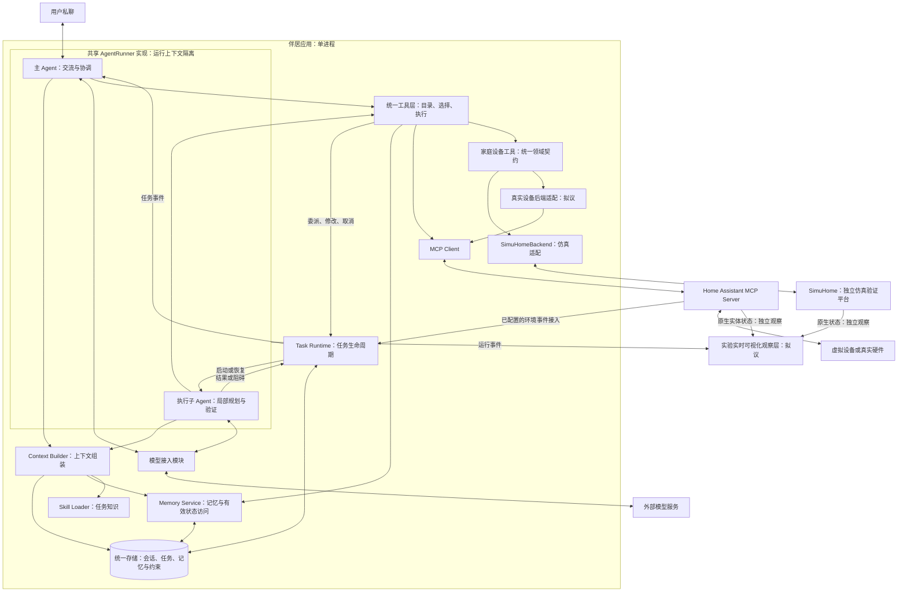

# 伴居 · 软件架构

规范状态：`PROPOSED` · 交付状态：`PLANNED`。

本文是产品范围、软件架构和模块职责的 Authority（权威位置）。家庭设备语义见[统一工具契约](device-contract.md)，状态定义、Maintainer（维护人）与阅读导航见[文档地图](index.md)。本文描述目标架构，现有本地实现与运行证据见[SimuHome 本地验证](simuhome.md)；逻辑组件名不等于已发布的稳定接口。

## 目标与范围

伴居是面向私聊的自适应家庭陪伴 Agent。它通过持续对话、长期记忆和环境行动理解用户，并根据用户纠正与执行反馈改善后续决策。家庭是感知、行动和实验的载体，Agent 是软件系统的主体。

当前架构范围：

- 只支持私聊交互，不引入群聊抢话、存在感评分或跨群注意力调度。
- 独立设计应用内核，复用模型服务、MCP 和 Home Assistant 等外部能力，不以裁剪完整群聊机器人为实现路线。
- 主 Agent 同时承担交流、意图理解和任务协调；暂不设置独立 Reply Agent。
- 执行子 Agent 根据目标完成局部家庭任务，不为每个房间或每类设备开发独立执行内核。
- 主、子 Agent 复用同一套执行循环，使用独立的运行上下文和工具范围。
- 先以虚拟家庭建立闭环，再用真实设备验证执行与反馈；两者复用上层 Agent 逻辑。
- 长期陪伴体验与算法效果分别评价，不将自然表达或记忆复述直接等同于自适应能力。

应用内按单进程、模块化组织。角色拆分不意味着多进程或微服务；外部模型服务、Home Assistant 与 MCP Server 不属于应用内进程边界。

## 软件架构图

下图表示拟议运行组件与交互关系，不是文档导航。所有应用组件均处于 `PROPOSED` 状态。

工具执行结果返回发起调用的 AgentRunner，进入其后续模型上下文。图中的共享模块表示复用实现和统一事实来源，不表示主、子 Agent 共享一份可随意修改的模型消息列表。

## 角色与运行内核

### AgentRunner

AgentRunner 负责一次运行中的模型—工具闭环：获取上下文、请求模型、分发工具、接收结果，再继续、等待或结束。运行应支持取消与执行上限；结束时明确说明任务完成程度，不能将停止运行视为任务成功。

主、子 Agent 的差异由角色、任务上下文、可用能力和输出要求表达，不复制两套循环。

| 维度 | 主 Agent | 执行子 Agent |
| --- | --- | --- |
| 职责 | 理解用户、自然交流、拆分和协调任务 | 查询环境、选择工具、编排动作、验证局部目标 |
| 上下文重点 | 用户原话、实际回复、相关记忆、任务概况 | 子任务目标、约束、相关偏好、设备事实与执行进度 |
| 能力范围 | 记忆、能力发现、任务委派与管理 | 当前任务范围内的设备查询和操作 |
| 输出 | 用户可见回复或工具调用 | 结构化执行结果、阻碍和需澄清事项 |
| 状态归属 | 私聊会话与其关联任务 | 当前子任务 |
| 人格 | 稳定的陪伴人格 | 中性执行角色，不建立第二套陪伴人格 |
| 委派能力 | 可创建执行子任务 | 当前设计不允许继续创建下级 Agent |

会话持久存在不意味着模型持续空转。普通对话由主 Agent 直接回复；只有需要局部执行时才创建子任务。执行子 Agent 必须能够循环使用工具和观察结果，不是仅执行一次模型请求的辅助函数。

### 模型接入模块

模型接入模块转换角色消息、工具定义、模型输出和错误，不承担业务规划、记忆更新或设备状态判断。实现时先接入一个实际模型服务，不预先开发所有供应商的兼容层。

主、子 Agent 可以使用同一模型；是否需要不同模型由后续实验决定，角色拆分本身不要求不同模型。

## 任务与事件

### 任务边界

Task Runtime 是普通程序模块，负责接单、保存状态、启动或恢复执行、接收事件和取消任务。它不再调用一个额外的模型来重复规划。

一项任务需要表达以下语义，具体字段与接口留待详细设计：

| 信息 | 用途 |
| --- | --- |
| 任务身份、所属会话与父任务 | 关联委派、结果和后续用户修改 |
| 目标与完成条件 | 区分发出命令和达成目标 |
| 工作范围与适用能力 | 确定房间、设备和操作范围 |
| 偏好及事实引用 | 明确决策依据，不将父对话全量复制给子 Agent |
| 约束与行动依据 | 表达本次要求及适用的持续委托 |
| 当前进度和等待原因 | 支持追问、暂停及恢复 |
| 动作结果与证据 | 汇总完成、部分完成、失败或取消情况 |

当前设计区分待调度、运行、等待用户、完成、部分完成、失败和取消。等待用户是可恢复状态；终结结果必须保留已经完成与尚未完成的部分。代码枚举、事件 Schema 和恢复协议尚未制定。

### 委派与反馈

委派工具返回任务标识和受理状态，不把受理当作执行完成。后续结果通过关联任务的事件进入主 Agent，不能伪装成原工具调用的第二份结果，也不能丢失与原目标的对应关系。

执行子 Agent 返回实际动作、完成证据、未解决事项和需澄清的问题，不直接向用户展开另一段对话。主 Agent 根据结果决定继续协调、询问用户或汇报。

同一私聊会话中的主 Agent 决策按序处理。设备执行期间仍可接收新消息；识别并提交的任务修改应影响后续动作。涉及同一设备的冲突写操作由 Runtime 协调，不能让两个子 Agent 相互覆盖。

取消不是回滚。尚未执行的动作应停止；已经发出或完成的动作保留其真实结果。不能因为收到取消请求就声称设备从未被操作。

### 输入事件

运行入口接收用户消息、关联的子任务反馈，以及已配置且符合委托条件的定时或环境事件。原始遥测先更新环境状态，不将每次传感器变化都转成模型请求。

MCP 工具调用不天然提供家庭事件订阅。环境触发需要使用 Home Assistant 支持的事件接口或明确的查询机制；具体接入方式属于后续技术选型。

保存任务与会话不代表具备崩溃后自动续跑能力。涉及在途设备操作的恢复，需要单独定义结果确认与重复执行语义，当前不承诺自动重放。

## 工具与设备接入

### 统一调用边界

工具层包含三个职责，而不是三个 Agent：

- Tool Catalog 保存工具说明、参数结构、来源和能力元数据。
- Tool Selector 为当前运行选择模型可见的工具。
- Tool Executor 检查参数、任务范围与当前有效约束，调用真实实现并记录结果。

工具调用与结果通过调用标识关联。结果保留业务成功或错误、必要的结构化内容及可用证据，不能只靠一段成功文案推断结果。

本地函数、任务委派和 MCP 工具使用统一执行入口。工具来源采用可区分的内部标识，避免不同服务的同名工具被误路由；不要求改写上游 MCP 协议。

### 动态暴露

必须区分系统已经接入的工具目录、当前模型可见的工具集合和实际允许执行的范围。发现工具不会自动扩大任务授权。

主 Agent 面向高层能力选择和任务委派；执行子 Agent 按目标与范围发现设备工具。发现结果由 Runtime 转为下一轮模型请求中的工具定义，不能只返回“已加载”的文字。

已选择能力属于任务运行状态。上下文压缩不应让任务范围和有效约束消失；模型仍需获得本轮实际可用工具的定义。任务结束后释放任务级选择，不删除工具目录或历史执行记录。

设备发现与工具暴露的候选策略、执行范围检查和子 Agent 的输入输出格式见[执行子 Agent 详细设计](executor-agent.md)，其比较方法见[对照实验](exposure-experiment.md)；比较结论确定前，本节不选定具体策略。

房间、设备类型和操作能力是筛选维度，不是互斥的目录所有者。同一台卧室空调既可用于卧室任务，也可用于全屋温控任务；不因此重复建立 Agent、MCP Server 或一套偏好数据。

### 外部集成

家庭设备工具通过[统一工具契约](device-contract.md)访问后端，AgentRunner 面向工具定义与结果运行。真实设备后端负责把统一标识、能力、动作和状态映射到 Home Assistant 等平台；Home Assistant 承担已有设备接入与状态抽象，MCP 可以承载其工具调用。

SimuHome 是独立的仿真验证后端，其 HTTP API 由 SimuHomeBackend 适配。平台的端点、Cluster 与命令字段在适配器内部处理；上层使用统一家庭能力。实验入口准备仿真场景并独立验证状态，运行循环与设备工具属于被测系统。当前接入方式和证据见[本地验证](simuhome.md)。

MCP 连接由应用管理，可被多个任务复用。按需向模型暴露工具，不等于每个任务都重新连接服务器，也不等于在服务器端维护按房间切换的工具列表。

设备反馈必须区分命令已接收、设备报告目标状态和实际环境变化。平台的乐观状态不能自动当作物理完成证据；没有反馈时应报告未确认，不伪装成功。

## 上下文与技能

Context Builder 根据角色和当前目标选择人格、对话、任务进度、相关记忆、有效约束、环境事实、Skill 与工具定义。各类内容保留来源和性质，不能把检索资料或设备文本当作更高优先级的指令。

主 Agent 能访问用户原话与实际发出的回复；执行子 Agent 获得完成任务所需的最小相关背景，而不是完整私聊副本。两者的模型上下文不同，但事实来源一致。

Skill 表达任务方法、适用条件、所需能力和引用资源。启动时可读取索引，任务需要时加载正文和资源；Skill 不拥有独立执行循环，也不自动授予工具权限。

当前不引入独立 Reply Agent。用户输出经统一发送与记录边界保存，执行结果保持结构化。将来若有独立表达层，其职责是基于已有事实组织回复，不能改写目标或声称未发生的操作已完成。

## 记忆与状态

### 分类与归属

记忆通过保存、检索、更新和重新注入上下文影响后续决策，不等于训练模型参数。

| 数据 | 语义与归属 | 使用原则 |
| --- | --- | --- |
| 会话记录 | 用户原话、实际回复及相关调用记录 | 为对话与来源回溯提供依据，不自动将所有内容变成长久事实 |
| 任务状态 | 当前目标、范围、进度、等待原因和动作结果 | 由 Task Runtime 管理，不依赖模型记住完整历史 |
| 经历记忆 | 发生过的交互、共同任务与反馈 | 保留场景和来源，不能将一次经历直接泛化为永久偏好 |
| 偏好与用户信息 | 用户明确表达或确认的可复用信息 | 按用户、情境和当前有效性使用 |
| 有效约束与持续委托 | 临时限制、条件性授权和撤销状态 | 结构化查询有效状态，不依赖相似度检索是否召回 |
| 实时设备状态 | 当前环境与设备反馈 | 通过环境接口获取，不以旧记忆替代 |

前五类可以共用物理存储，但保留不同语义。实时设备信息可以记录为事件证据，历史记录仍不是当前状态。

### 记忆记录

记忆至少需要能表达类型、内容或结构化值、所属用户、适用情境、来源、记录时间、有效状态及更新关系。上述是逻辑要求，不是已确定的数据库 Schema。

时间、设备归属与来源标识必须来自实际消息、环境或明确配置，不能用占位事实补齐。对“今晚”等时效表达，应结合明确的时间或场景边界解释；无法确定且会影响行为时需要澄清，不能静默视为永久。

### 写入、读取、更新与遗忘

Memory Service 提供统一访问和变更入口，不为每个房间维护独立用户画像。

- 写入：区分用户明确陈述、假设、引用他人和推测。先支持明确要求保存或经过确认的信息；从反复行为推断的新偏好作为候选，不直接覆盖已知事实。
- 读取：先按用户、场景和有效性筛选，再检索相关内容。向量检索是可选的语义查找方式，不能决定授权或失效状态。
- 更新：明确被修改的信息和适用范围。当前偏好与历史版本有可追溯关系，旧值不再作为现行值使用。
- 遗忘：同步处理记录的使用状态与相关索引，避免从旧材料中自动重新提取。删除保存的记忆与删除原始会话是不同操作，产品必须明确其范围。

以下为语义示例，不是用户实际偏好或系统默认值：

| 用户表达 | 状态变化 |
| --- | --- |
| “记住，我在卧室睡觉时喜欢 26℃” | 保存卧室睡眠偏好，不产生自动控制授权 |
| “这一次调到 27℃” | 修改当前任务，不覆盖长期偏好 |
| “以后睡觉改成 27℃” | 更新相同情境的长期偏好，旧值退出当前有效集合 |
| “当我明确启动睡眠场景时，自动按偏好调温” | 建立条件明确的持续委托，偏好与授权独立保存 |
| “以后不要自动调温了” | 撤销相关委托，不必删除温度偏好 |

执行子 Agent 读取相关视图，返回观察与纠正线索；长期变更通过统一入口处理。执行前重新检查当前有效约束，不能只依据任务创建时的旧快照。

## 反馈与自适应

反馈处理是记忆和任务更新机制，不设置独立常驻“成长 Agent”。它首先判断反馈对象：当前任务、临时例外、长期偏好、持续委托，或设备执行结果。

明确的用户修改应在后续受影响的动作前生效。设备离线不代表用户偏好改变；相反，纠正偏好也不意味着可以忽略设备失败。

自适应研究围绕有边界的候选更新展开：情境适用范围、偏好变化和澄清行为。候选策略可在隔离仿真环境中评估，再决定是否应用。仿真可以验证约束和模拟目标，不能独自证明真实用户满意。

反馈学习不自动授予新权限，不以重写系统规则、修改代码或递归创建 Agent 作为当前架构的一部分。

## 仿真与实物边界

仿真与实物复用 AgentRunner、任务流程、记忆机制和工具契约，不构建一套只用于演示的特殊决策逻辑。设备能力通过相同接入层尽量保持一致；不支持的能力应显式表达，而不是伪造成功反馈。

实验入口可以输入可重复的用户消息、环境事件、时间条件与设备故障，并从任务记录提取结果。实验使用隔离的设备目标和状态存储，不影响真实家庭或用户记忆。

实验 Agent 的专属文件按[名称目录约定](index.md#实验-agent-目录约定)归入实验仓库，共享运行内核与统一工具由 `runtime/` 提供。拟议的实时观察层展示实际执行事件、设备状态与独立确认结果。它直接读取设备平台的原生状态，不经过被测 Agent 使用的家庭设备工具：工具属于被测环境，观察若经过工具，工具缺陷会同时影响 Agent 与观察方而无法被发现。具体观察要求与交付状态见[实时可视化观察层](simuhome.md#实时可视化观察层)。

仿真用于重复验证长期交互中的状态变化；实物用于检验实际反馈、延迟、离线和部分执行等情况；陪伴体验需要用户评价。三者提供不同证据，不能相互替代。

硬件联锁、限位、急停和实时控制由设备或确定性控制系统承担。模型与网络不可用时，不应使实体操作和已部署的基础控制失效。

## 取舍与详细设计边界

当前采用的取舍：

- 两种角色共用运行内核，不建立多级 Agent 组织。
- 保留人格、共同经历和偏好，不引入群聊运营机制。
- 工具目录和任务范围独立于提示词，避免靠模型自行维持真实状态。
- 复用外部设备生态，不自研一套智能家居协议。
- 状态按语义分开，不为了分层立即引入多个数据库、微服务或消息中间件。
- 独立 Reply、多端应用、可穿戴情绪感知、自主生成 Skill、自改代码与完整外部 RSI 不属于当前必做范围。

以下议题需在实现前细化，并由维护人确认；本文不将其伪装成已发布契约：

| 议题 | 尚需确定的内容 |
| --- | --- |
| 技术选型 | 目标系统语言、模型服务、记忆后端及依赖版本；当前本地试验采用 Python 标准库和 OpenAI-compatible 模型接口，实际模型仍由运行配置确定 |
| 任务契约 | 消息与事件 Schema、状态迁移细节、资源冲突协调、在途操作与进程恢复语义 |
| 记忆契约 | 数据 Schema、自动提取边界、时间解释、冲突更新及遗忘覆盖范围 |
| 能力契约 | 工具身份、房间与设备元数据来源、范围过滤和动态发现接口 |
| 环境接入 | Home Assistant 版本、实际暴露能力、事件入口和目标设备 |
| 自适应评测 | 可重复场景、对照与消融方法、指标定义和候选策略应用条件 |

这些是架构的后续细化边界，不是空实现或已交付功能。

## 验证边界

当前已有本地小 Agent 代码和 SimuHome 接口验证。具体运行方法、证据覆盖和未运行项见[SimuHome 本地验证](simuhome.md#证据覆盖)。真实模型、MCP、真实设备及其环境效果分别提供证据，整体目标架构保持草案状态。

文档结构和链接检查只能证明文档组织的一致性，不能证明运行架构有效，也不推进软件交付状态。系统验证证据应随后续实现及实验记录提供。
